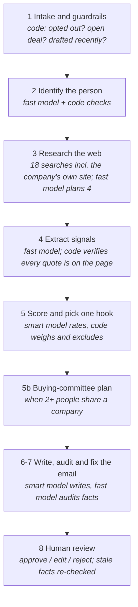

# Signal: a cold-email outreach agent that never sends

An SDR uploads a CSV of prospects (name plus a company domain or LinkedIn URL). For each one, a fixed pipeline confirms who the person is, researches the public web, picks **one cited hook**, and writes a short first-touch email (under 120 words). Every factual sentence links to the source that proves it. Drafts wait in a review queue: a human approves, edits or rejects each one. **Nothing is ever sent.** The live run view streams every stage as it happens, and a dashboard shows what reached review and why the rest didn't.

## How one prospect is processed



Code owns the flow; a model only makes judgements inside a stage. Any stage can stop a run with a clear status (needs input, low signal, held, suppressed, already drafted…). The generated, always-current diagram is [agents/PIPELINE_DIAGRAM.md](agents/PIPELINE_DIAGRAM.md).

**Guardrails worth knowing:** LinkedIn is never fetched. Web text is untrusted (it reaches models inside `<untrusted_source>` tags and AI-screening traps are detected). Sensitive news and competitor news are never hooks. An email with an unsupported fact cannot be approved. Opted-out prospects are suppressed, and open deals are routed to their owner.

## Run it locally

You need Python 3.13 and Node 20+. Every API key is free, with no card required.

```bash
# 1. Backend
cd backend
python -m venv .venv
.venv\Scripts\activate            # Windows   (macOS/Linux: source .venv/bin/activate)
pip install -r requirements.txt
copy .env.example .env            # macOS/Linux: cp .env.example .env, then add your keys
python -m scripts.seed_context    # fake CRM / outreach history for the edge cases
uvicorn app.main:app --reload --port 8000

# 2. Frontend (second terminal)
cd frontend
npm install
npm run dev                       # http://localhost:3000
```

With `make` installed, `make setup`, `make dev-api` and `make dev-web` do the same.

**Showing the demo (no keys or network needed):** start the backend in demo mode with `make dev-api-demo`, or on Windows `powershell -ExecutionPolicy Bypass -File run-demo.ps1`. Then use **"Use the demo CSV"** (9 prospects, one per feature: happy path, buying committee, AI screening trap, hostile instruction, warm follow-up, open deal, stale draft) or **"Try a messy CSV"** (odd column names, ALL-CAPS names, a LinkedIn-only row, missing data, a duplicate). Every search and model answer is replayed from `backend/tests/fixtures/demo`, in its own database (`backend/demo.db`).

**Tests:** `cd backend && python -m pytest -q`. The offline demo check is `python -m scripts.check_demo`. It replays every demo row and compares each with its expected outcome in `seed/demo_cases.json`.

## Deploy (free, no credit card)

Each service is set up by importing this GitHub repo; the config files do the rest. Step by step: **[docs/DEPLOYMENT_GUIDE.md](docs/DEPLOYMENT_GUIDE.md)**.

| Part | Host | Config | You only paste |
|---|---|---|---|
| Database | Neon | [neon.ts](neon.ts) | nothing (`neon deploy` writes `.env.local`) |
| Backend | Render (Blueprint) | [render.yaml](render.yaml) | the two Neon URLs from `.env.local`, the Groq/Gemini/Tavily keys |
| Frontend | Vercel (Root Directory `frontend`) | [frontend/vercel.json](frontend/vercel.json) | `NEXT_PUBLIC_API_URL` = the Render URL |

CORS needs no input: the backend already accepts the Vercel project `zamp-sdr` (production and preview URLs). Render's free plan sleeps after 15 idle minutes, so open the site a few minutes before a demo. A shared link can't drain the free quotas: each visitor gets 20 uploads and 60 drafted prospects per hour (`uploads_per_hour`, `prospects_per_hour` in [backend/app/config.py](backend/app/config.py)).

## Where things live

| Path | What it is |
|---|---|
| [agents/](agents/) | **Every word a model reads**, one file per stage. Edit these to change behaviour; no Python needed. [agents/README.md](agents/README.md) lists them. |
| `agents/stage2_identify_person.md` … `stage8_recheck_stale_facts.md` | The prompts, named by stage and job |
| [backend/app/pipeline/](backend/app/pipeline/) | One module per stage; `graph.py` wires them as a LangGraph graph |
| [backend/app/config.py](backend/app/config.py) | Every number: score weights, cut-offs, search and read caps, limits |
| [seller_profile.yaml](seller_profile.yaml) | What "we" sell, the ideal customer, tone, personas, competitors |
| [frontend/](frontend/) | Next.js app: upload → map columns → prospect list → live run view → review queue → dashboard |
| [ASSUMPTIONS.md](ASSUMPTIONS.md) | Every assumption and design decision, with the reason |
| [docs/PROJECT_SPEC.md](docs/PROJECT_SPEC.md) | The full specification: stages, edge cases, build tasks |
| [docs/DEPLOYMENT_GUIDE.md](docs/DEPLOYMENT_GUIDE.md) | Deploying to Neon, Render and Vercel, step by step |
| [docs/TECHNICAL_BRIEF_PROMPT.md](docs/TECHNICAL_BRIEF_PROMPT.md) | A complete technical brief to paste into an AI assistant |
| [CLAUDE.md](CLAUDE.md) | Working notes for the coding assistant (stack, commands, conventions) |

## Stack

FastAPI · SQLModel (SQLite locally, Postgres deployed) · LangGraph · LangChain `ChatOpenAI` against Groq (`gpt-oss-120b` / `gpt-oss-20b`) with Gemini as fallback · Tavily, then DuckDuckGo, then Exa for search · trafilatura · Next.js 16 · Tailwind v4 · shadcn/ui · Server-Sent Events for live updates.
