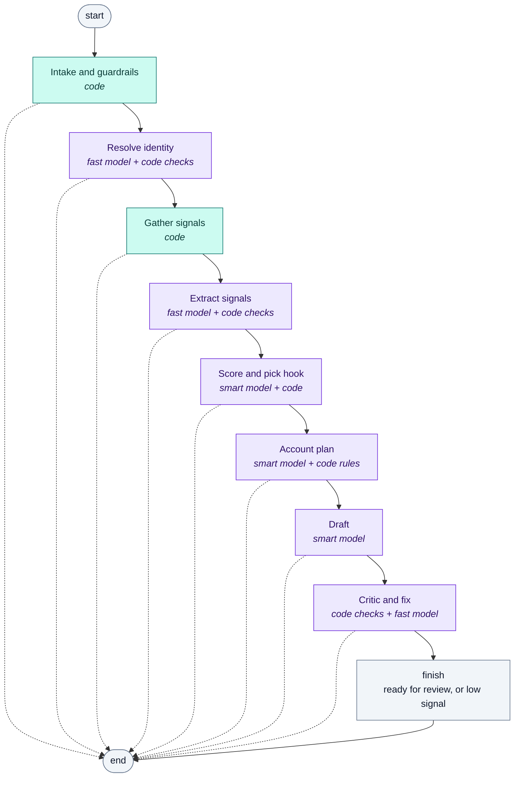
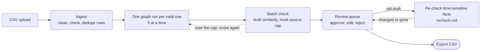

# The pipeline

> Generated by `backend/scripts/draw_pipeline.py` from the LangGraph graph in
> `backend/app/pipeline/graph.py`. Do not edit by hand: change the code, then run the script.

Every prospect in a CSV runs through this graph on its own. Code decides the order; a model
only makes judgements inside a stage. Each stage that uses a model has its words in an
[agent file](README.md).

## One prospect, stage by stage

Solid arrows: the next stage. Dotted arrows to the end: any stage can stop the run early
with a status (blocked, suppressed, held, needs input, low signal, failed), and the stages
after it are marked "not run".

Teal: code only. Purple: a model is involved.

| Stage | Name in code | Decided by | Prompt file |
|---|---|---|---|
| Intake and guardrails | `intake` | code | none (code only) |
| Resolve identity | `resolve` | fast model + code checks | [resolve.md](resolve.md) |
| Gather signals | `gather` | code | none (code only) |
| Extract signals | `extract` | fast model + code checks | [extract.md](extract.md) |
| Score and pick hook | `score` | smart model + code | [score.md](score.md) |
| Account plan | `account_plan` | smart model + code rules | [account_plan.md](account_plan.md) |
| Draft | `draft` | smart model | [draft.md](draft.md) |
| Critic and fix | `critic` | code checks + fast model | [draft.md](draft.md) |

## Before and after the graph

The graph is one prospect. Around it, the app also does these things (plain code, no graph):

Inside the graph, two stages work across prospects: **gather** and **extract** share one
search and one extraction per company, and **account_plan** waits for colleagues at the same
company so each gets a different opener.
